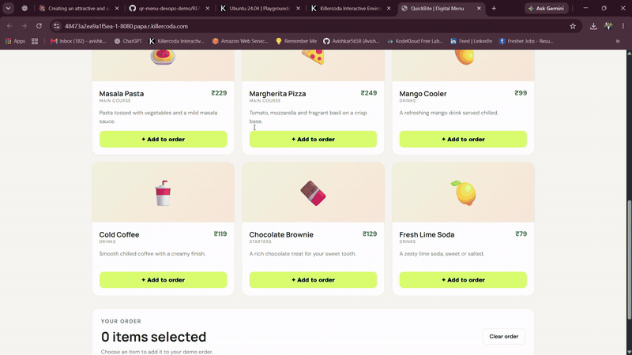
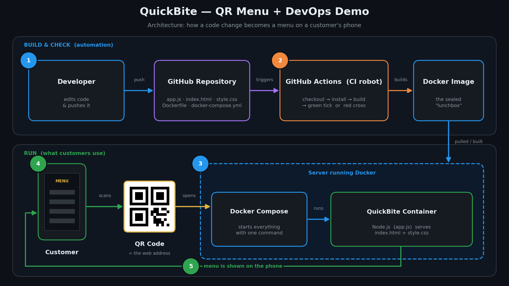
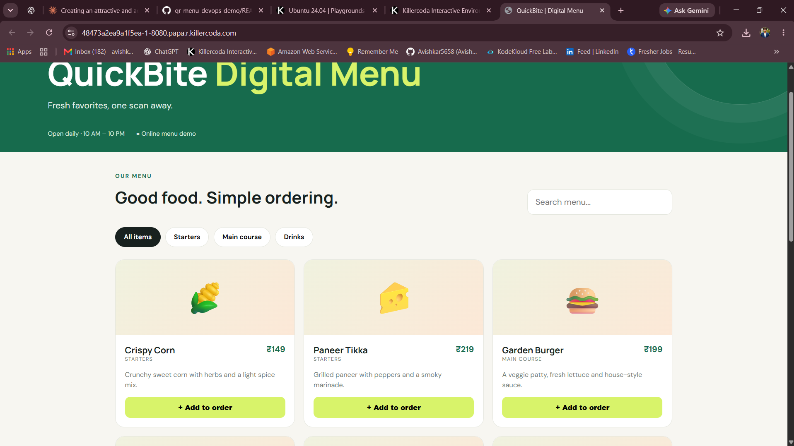
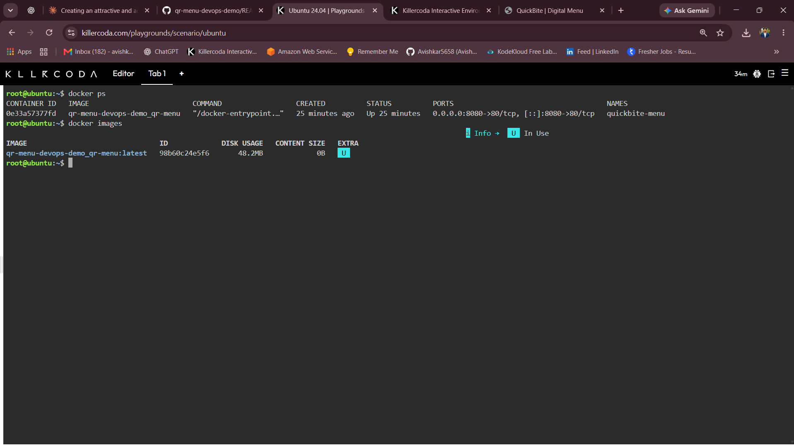

<div align="center">

# 🍔 QuickBite — QR Menu + DevOps Demo

### Scan a QR code. See the menu. Powered by a fully automated DevOps pipeline.


<br>



<sub>👆 <b>Live demo:</b> a customer scans the QR code and the menu opens instantly on their phone. No app, no paper menu.</sub>

</div>

---

## 📑 Table of Contents

1. [The Problem](#-the-problem-in-plain-english)
2. [The Solution](#-the-solution)
3. [Architecture](#-architecture)
4. [Tools Used and Why](#-tools-used-and-why)
5. [How the Automation Works (CI Pipeline)](#-how-the-automation-works-ci-pipeline)
6. [Demo and Screenshots](#-demo-and-screenshots)
7. [Quick Start: Run It in 3 Commands](#-quick-start-run-it-in-3-commands)
8. [Step-by-Step Implementation](#-step-by-step-implementation)
9. [Make Your Own QR Code](#-make-your-own-qr-code)
10. [Challenges and What I Learned](#-challenges-and-what-i-learned)
11. [Cleanup](#-cleanup)
12. [Future Improvements](#-future-improvements)
13. [Use This Project in Your Own Repo](#-use-this-project-in-your-own-repo)

---

## 🤔 The Problem 

Think about a busy café or restaurant.

**The old way:** printed paper menus.

- 😟 Changing a price or adding a dish means **reprinting every menu**
- 😟 Menus get dirty, torn or lost
- 😟 Customers wait for a waiter just to see what's available
- 😟 Sold-out items are still listed, which leads to disappointed guests

And on the technical side, there's a second problem: when developers update a website by hand, mistakes happen, and every machine ends up set up slightly differently ("but it works on my laptop!").

## 💡 The Solution

**QuickBite** is a digital menu that opens when a customer **scans a QR code** at the table. Update the menu once, and every customer sees the new version immediately.

The project also shows **how professionals ship software safely**: the app is packed into a **Docker container** (so it runs the same everywhere) and every change is **automatically checked** by a **CI pipeline** before it is accepted.

> 📦 **Lunchbox analogy**
>
> Imagine cooking a meal and sealing it in a **lunchbox**. Wherever you carry it, school, office or a picnic, the meal inside stays exactly the same.
>
> **Docker** does this for software. The app and everything it needs are sealed in one "box" (a *container*) that runs the same on any computer.

| Term | Simple meaning |
|------|----------------|
| 📱 **QR Menu** | A menu you open by scanning a square barcode with your phone camera |
| 🐳 **Docker** | A tool that packs an app into a portable "box" so it runs the same everywhere |
| 🧩 **Docker Compose** | A single file that starts the whole app with one command |
| 🤖 **CI (Continuous Integration)** | A robot that automatically tests and builds the project every time code changes |
| 🔧 **DevOps** | Practices that help teams build, test and release software faster and more reliably |

### ✅ Result

**A working QR menu that anyone can start with one command, and a robot that checks every change automatically.**

---

## 🏗️ Architecture

<div align="center">
  
</div>

**How to read the diagram (follow the arrows):**

1. 👩‍💻 A **developer** changes the code and pushes it to **GitHub**.
2. 🤖 **GitHub Actions** (the robot) wakes up, builds the app and checks that nothing is broken.
3. 🐳 The app runs inside a **Docker container**, started by **Docker Compose**.
4. 📱 A **customer** scans the **QR code**, which opens the app's web address.
5. 🍽️ The app shows the **menu** on the customer's phone.

```
 Developer ──push──▶ GitHub ──▶ GitHub Actions (build + check)
                                        │
                                        ▼
                              Docker image (the "lunchbox")
                                        │
                              Docker Compose starts it
                                        │
 Customer 📱 ──scan QR──▶ Web address ──▶ QuickBite menu 🍔
```

---

## 🧰 Tools Used and Why

| Tool | What it is (simple) | Why it's used here |
|------|---------------------|--------------------|
| **HTML + CSS** (`index.html`, `style.css`) | The look and layout of a web page | The menu customers see on their phone |
| **Node.js** (`app.js`) | The "engine" that serves the web page | Runs the app and delivers the menu |
| **Docker** (`Dockerfile`) | A recipe for building the app's "box" | Makes the app run identically on any computer |
| **Docker Compose** (`docker-compose.yml`) | A one-file launcher | Starts the whole app with a single command |
| **GitHub Actions** (`ci.yml`) | A robot that runs checks on every change | Catches problems early, automatically |
| **Git + GitHub** | Version history and online storage for code | Tracks every change and enables the automation |

---

## 🤖 How the Automation Works (CI Pipeline)

Every time code is pushed to GitHub, the robot follows these stages. If any stage fails, the change is flagged **before** it can cause problems.

| Stage | What the robot does | Why it matters |
|:-----:|---------------------|----------------|
| **1. Checkout** 📥 | Downloads the latest code | Starts from a clean copy |
| **2. Install** 📦 | Installs the app's dependencies | Confirms the app can be set up from scratch |
| **3. Build** 🐳 | Builds the Docker image from the `Dockerfile` | Proves the "lunchbox" can be packed correctly |
| **4. Result** ✅ / ❌ | Shows a green tick or a red cross on the commit | Everyone can see at a glance if the change is safe |

> ✏️ *Adjust the stages above so they match what your `ci.yml` actually does.*

---

## 📸 Demo and Screenshots

> 📷 *Add your own screenshots to the `screenshots/` folder. Real proof makes the biggest impression.*

### 📱 The menu on a phone

<table>
  <tr>
    <td align="center" width="50%"><b>🔲 The QR code</b><br><sub>What the customer scans</sub></td>
    <td align="center" width="50%"><b>🍔 The menu</b><br><sub>What opens on the phone</sub></td>
  </tr>
  <tr>
    <td></td>
    <td></td>
  </tr>
</table>

### 🐳 The container is running

Proof that the app is running inside Docker:

<div align="center">
  
</div>

### ✅ The robot approves every change

The green tick means the automatic checks passed:

<div align="center">
  
</div>

---

## ⚡ Quick Start: Run It in 3 Commands

You need only **[Docker](https://docs.docker.com/get-docker/)** and **[Git](https://git-scm.com/downloads)** installed.

```bash
# 1. Download the project
git clone https://github.com/Avishkar5658/qr-menu-devops-demo.git
cd qr-menu-devops-demo

# 2. Start it
docker compose up -d --build

# 3. Open it in your browser
# http://localhost:3000
```

> ✏️ *Replace `3000` with the port your `app.js` and `docker-compose.yml` actually use.*

🎉 That's it! The QuickBite menu is now running on your computer.

To stop it:

```bash
docker compose down
```

---

## 🛠️ Step-by-Step Implementation

### ✅ Prerequisites

- [Docker](https://docs.docker.com/get-docker/) installed (Docker Desktop on Windows/Mac, Docker Engine on Linux)
- [Git](https://git-scm.com/downloads) installed
- A free [GitHub account](https://github.com/) (for the CI pipeline)
- A text editor such as [VS Code](https://code.visualstudio.com/)

---

### Step 1️⃣ — Get the code

```bash
git clone https://github.com/Avishkar5658/qr-menu-devops-demo.git
cd qr-menu-devops-demo
```

### Step 2️⃣ — Understand the files

| File | What it does |
|------|--------------|
| `index.html` | The menu page structure |
| `style.css` | Colors, fonts and layout |
| `app.js` | The app logic that serves the page |
| `Dockerfile` | Instructions to pack the app into a container image |
| `docker-compose.yml` | Starts the container with the right settings |
| `ci.yml` | The GitHub Actions workflow (the automation robot) |

### Step 3️⃣ — Build and run with Docker Compose

```bash
docker compose up -d --build
```

- `up` → start the app
- `-d` → run quietly in the background
- `--build` → build a fresh image first

### Step 4️⃣ — Check that it's running

```bash
docker compose ps
```

You should see the QuickBite container with the status **Up**. Now open `http://localhost:3000` in your browser. 🍔

### Step 5️⃣ — Turn on the automation (CI)

GitHub only runs workflows stored in a specific folder. Place the workflow file here:

```
.github/workflows/ci.yml
```

Then push your code:

```bash
git add .
git commit -m "Enable CI pipeline"
git push
```

Open the **Actions** tab of your repository and watch the robot run. A green ✅ means success.

### Step 6️⃣ — Change the menu and see it update

1. Open `index.html` and edit a dish name or price
2. Rebuild and restart:

```bash
docker compose up -d --build
```

3. Refresh the browser. The new menu appears. 🎉

---

## 🔲 Make Your Own QR Code

The QR code is just a **picture of a web address**.

1. Deploy the app somewhere with a public address (for example an AWS EC2 server), or use a tunnel tool while testing
2. Open any free QR generator (search "QR code generator")
3. Paste your web address and download the image
4. Print it and stick it on a table, or save it in `screenshots/qr-code.png`
5. Scan it with your phone camera. Your menu opens. 📱

> 💡 **Tip:** `localhost` only works on your own computer. A QR code needs an address your customers' phones can reach.

---

## 🎓 Challenges and What I Learned

> ✏️ *Replace the rows below with problems you actually faced. Genuine lessons stand out the most.*

| Challenge | How I solved it |
|-----------|-----------------|
| The page didn't open after starting the container | Checked the port mapping in `docker-compose.yml` and matched it to the port used in `app.js` |
| The CI pipeline never started | Moved the workflow file into `.github/workflows/` |
| Changes to the menu didn't show up | Rebuilt the image with `--build` so Docker used the latest files |

**Key takeaways**

- ✅ How **Docker** makes an app run the same on any machine
- ✅ How **Docker Compose** starts a project with one command
- ✅ How **CI pipelines** catch problems automatically
- ✅ How a simple idea (a QR menu) can be delivered the **DevOps way**

---

## 🧹 Cleanup

When you're done, free up your computer's resources:

```bash
# Stop and remove the containers
docker compose down

# (Optional) remove the built image as well
docker compose down --rmi local
```

---

## 🔮 Future Improvements

- [ ] 🗄️ Store the menu in a **database** so it can be edited without touching code
- [ ] 🛒 Let customers **place orders** from their phone
- [ ] 🚀 Add **Continuous Deployment (CD)** to publish automatically after CI passes
- [ ] ☁️ Deploy on **AWS** (EC2, ECS or Elastic Beanstalk)
- [ ] 🔐 Add **HTTPS** with a free certificate
- [ ] 📦 Push the image to **Docker Hub** or **GitHub Container Registry**
- [ ] 📈 Add **monitoring** with Prometheus and Grafana

---

## 🔁 Use This Project in Your Own Repo

Want to try it or add it to your own portfolio?

1. **Fork** this repository (top-right button) or download it as a ZIP
2. Run it locally with the [Quick Start](#-quick-start-run-it-in-3-commands)
3. Customize the menu: edit dishes, prices and colors in `index.html` and `style.css`
4. Replace the restaurant name **QuickBite** with your own brand
5. Replace the screenshots in `screenshots/` with **your own**
6. Write your own **Challenges and What I Learned** section
7. ⭐ If it helped you, give the repo a star!

### 📁 Repository structure

```
qr-menu-devops-demo/
├── README.md
├── Dockerfile              # Recipe for the container image
├── docker-compose.yml      # One-command launcher
├── app.js                  # App server
├── index.html              # Menu page
├── style.css               # Menu styling
├── .github/
│   └── workflows/
│       └── ci.yml          # Automation pipeline
└── screenshots/
    ├── demo.gif
    ├── architecture.png
    ├── qr-code.png
    ├── menu-mobile.png
    ├── docker-running.png
    └── github-actions-success.png
```

---

## 👤 Author

**Avishkar Thorave**

[](https://github.com/Avishkar5658)
[](https://www.linkedin.com/in/avishkar-thorve-a77a8b2a1)

---

<div align="center">

⭐ **If you found this useful, give it a star!** ⭐

*Built with 🐳 Docker and a lot of curiosity.*

</div>
